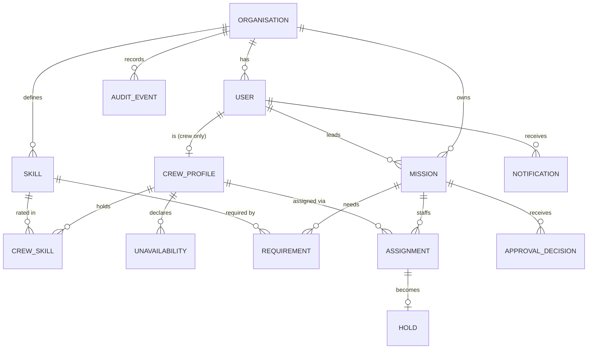
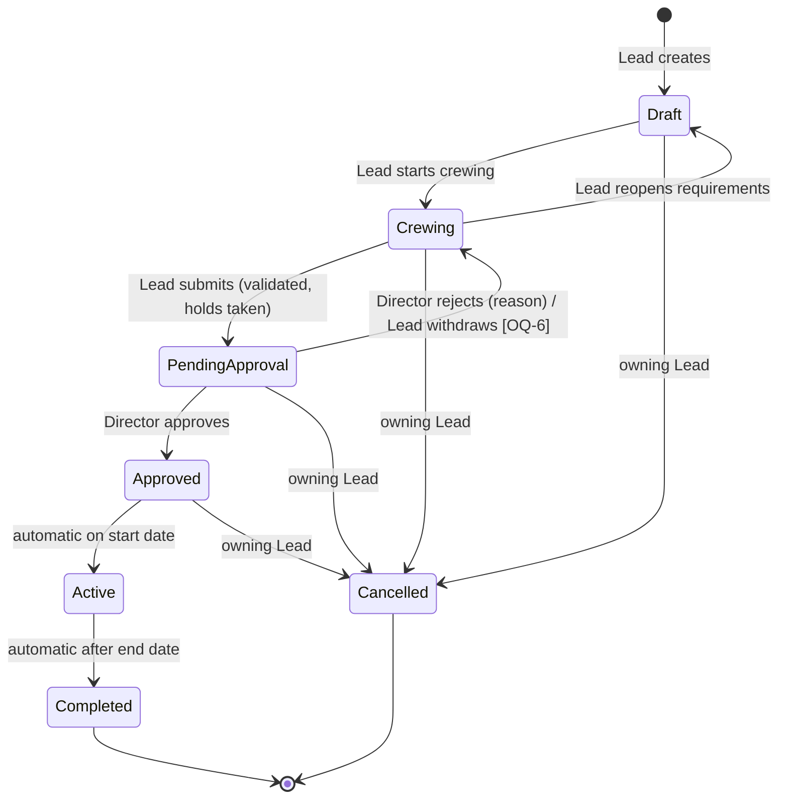

# Mission Control — Design Document

| | |
|---|---|
| **Status** | Draft for engineering review |
| **Date** | 29 September 2026 |
| **Scope** | Core platform: multi-tenant API, roles, mission lifecycle & approval, crew & skills, auto-matching engine, CLI |
| **Audience** | Engineering team and AI coding agents implementing the core |

---

## 1. Summary

Mission Control is a multi-tenant B2B platform that lets space organisations plan missions and staff them with the right crew. Today, Mission Leads assign crew by hand, cross-referencing skill profiles, calendars and existing commitments. That is slow and error-prone.

The core delivers four things:

1. **A strictly tenant-isolated API** with three organisation roles (Director, Mission Lead, Crew Member), enforced both in application code and by PostgreSQL row-level security.
2. **A mission lifecycle** in which a Lead defines requirements, assembles a crew, and submits the mission for approval by a Director. A Lead can never approve their own mission.
3. **An auto-matching engine** that proposes the best whole team for a mission. It satisfies hard constraints (skills, availability, existing commitments, workload caps), balances workload across the organisation, and explains any requirement it cannot meet.
4. **A CLI (`mc`)** through which every primary workflow can be exercised end to end.

---

## 2. Goals and non-goals

### Goals

- No data ever crosses tenant boundaries, even in the presence of an application bug.
- The lifecycle is explicit, enforced server-side, and every transition is audited.
- No crew member is ever double-booked on overlapping missions or pushed beyond the organisation's workload cap. The database enforces this, not only the application.
- Matching results are deterministic, explainable and reproducible.
- Every primary workflow is scriptable from the CLI.

### Non-goals (for the core)

- Web UI. The API is designed so a UI can be added later.
- External notification delivery (email, push, webhooks). Notifications are an in-app inbox only.
- Sub-day scheduling. All timing is in whole days.
- Users belonging to more than one organisation.
- Configurable approval chains. Approval is a single Director decision in every organisation.
- Verification of skill levels. Levels are self-declared and trusted as-is.
- SSO / external identity providers.

---

## 3. Confirmed product decisions

These were confirmed with the product owner and are binding for implementation.

| Area | Decision |
|---|---|
| Stack | TypeScript on Node.js; PostgreSQL |
| Tenant isolation | Shared database and schema; `org_id` on every tenant row; enforced in the data-access layer **and** by PostgreSQL row-level security (RLS) as a backstop |
| Authentication | Built-in login with organisation ID, email and password, issuing short-lived JWT access tokens; the CLI stores tokens locally. Refresh tokens and invite codes carry the organisation ID, so every authentication step runs through the normal tenant path |
| Tenancy provisioning | A platform operator creates organisations and each organisation's first Director. Each user belongs to exactly one organisation |
| Roles | Exactly one role per user: Director, Mission Lead or Crew Member |
| Approval | One Director approval, same rule in every organisation. Directors do not create or lead missions, so a Lead can never approve their own mission |
| Skills | Each organisation defines its own skill catalogue. Crew hold skills at a proficiency level 1–5 |
| Skill levels | Self-declared by crew members and used by the matcher as-is |
| Requirements | A mission has one or more skill requirements of the form "N people with skill S at level ≥ L". One person may satisfy several requirements. There is no separate crew size: the team is whatever set of people fulfils the requirements |
| Role changes | A Crew Member can be changed to Lead or Director; nobody can ever become a Crew Member (Crew Members are created only by invitation with the Crew role). The same blocking conditions as deactivation apply (OQ-4). A former Crew Member's profile and its data are kept but dormant: not listed, not matchable |
| Scheduler failures | A failure while processing one organisation is logged, raised as an alert (§16.1) and the scheduler continues with the next organisation |
| Clock override (tests) | A test-only endpoint, absent from production builds (§19) |
| Time model | Whole days (dates only) |
| Availability | Crew are available by default. Crew members add and remove their own unavailable date ranges |
| Workload | Measured as the number of upcoming missions a person is committed to, against an organisation-set maximum |
| Commitments ("holds") | Assignments become binding holds when a mission is submitted for approval, and stay held through Approved and Active. Holds block overlapping missions and count toward the workload cap. Assignments on a mission still being crewed are tentative |
| Lifecycle | Draft → Crewing → Pending approval → Approved → Active → Completed, plus Cancelled. The crew is confirmed before submission |
| Rejection | A Director rejects with a reason; the mission returns to Crewing for changes and fresh approval |
| Approved missions | Locked. They cannot be edited, only cancelled |
| Activation & completion | Automatic by date |
| Cancellation | Only the owning Mission Lead can cancel, and only before the mission becomes Active. Directors cannot cancel. Active missions always run to Completed |
| Mission ownership | Only the Lead who owns a mission can edit, crew, submit or cancel it. Other Leads can view it |
| Assignment response | Assignments are binding. Crew members acknowledge receipt; they cannot refuse |
| Notifications | In-app inbox, readable via API and CLI |
| Visibility | Directors see everything in their organisation. Leads see all missions and all crew profiles. Crew Members see only their own profile and their own assignments. A Crew Member sees a mission from Approved onward (Approved, Active, Completed), and still sees one that was cancelled after being approved (they were told about it); never one cancelled before approval |
| Denials | A role or ownership that can never perform an action gets 403, whatever the state (a Director submitting, a Lead approving, a Lead acting on another Lead's mission, Crew anything). An actor who may perform it but not in the mission's current state gets `409 MISSION_INVALID_TRANSITION` with the actions allowed now |
| Submit errors | A failed submit names the kind and the people (`CREW_NOT_ACTIVE`, `CREW_UNAVAILABLE`, `CREW_DOUBLE_BOOKED`, `WORKLOAD_CAP_EXCEEDED`, `REQUIREMENTS_NOT_MET`, `MISSION_CREW_EMPTY`), unlike the generic `NOT_ELIGIBLE` of the crew validation on reads |
| Matcher objective | Propose the best whole team at once (not seat by seat), subject to hard constraints, favouring balanced workload |
| Infeasible matches | Return the best partial team plus each unmet requirement and why it could not be met |
| Audit | All state changes (lifecycle, assignments, roles, settings, profiles) are audited; Directors can read the log, newest first. Bare dates in its filters are UTC days (`since` inclusive, `until` exclusive) |
| Unavailability | A range that ends in the past (organisation time zone) is rejected, and so is one that overlaps another of the same person's ranges. The `note` is private to its owner: Directors and Leads see the ranges only, and the audit log never contains it |
| Crew search | "Available" for a window means no overlapping unavailability and no overlapping live hold; the workload cap is not considered. Only active Crew Members are listed |

---

## 4. Open questions

These were not covered by the decisions above. Each has a **proposed default** that the implementation will use unless the product owner overrides it. They are marked `[OQ-n]` where they appear in this document.

| ID | Question | Proposed default |
|---|---|---|
| OQ-1 | Can a crew member add an unavailable range that overlaps a mission they are held on (Pending approval, Approved or Active)? | **No.** The API rejects it with a conflict listing every conflicting mission in full (id, name, dates, status), including ones still Pending approval. The crew member must speak to the Lead, who can withdraw/re-crew a pending mission or cancel an approved one |
| OQ-2 | What is the default maximum number of upcoming missions per crew member? | **3**, configurable per organisation by a Director (range 1–20) |
| OQ-3 | Can a crew member see who else is on their missions? | **No.** Crew see mission name, description, dates and their own assignment only |
| OQ-4 | Can a user be deactivated while they hold commitments? | Crew Members: **no**, not while they have holds. Mission Leads: **no**, not while they own missions that are not Completed or Cancelled (ownership transfer is out of scope). Directors: **no** if they are the last active Director |
| OQ-5 | Can a crew member edit their skill levels while held on a mission? | **Yes.** Levels only affect future matching; existing assignments are not re-evaluated |
| OQ-6 | Can a Lead withdraw a mission from Pending approval back to Crewing without a Director decision? | **Yes**, releasing holds, audited |
| OQ-7 | Who manages the skill catalogue? | **Directors** (it is an organisation setting). Skills cannot be archived or deleted in the core (archiving is future work, §22) |
| OQ-8 | When are crew notified of an assignment? | **On approval**, since crew cannot see assignments before then. Also notified if an approved mission they are on is cancelled |
| OQ-9 | In which time zone do date-based transitions happen? | The organisation's configured IANA time zone (default `UTC`), set by a Director |
| OQ-10 | Who can read alerts (§16.1)? | Alerts are tenant-scoped (they carry an `org_id`) and are read by the **Directors of that organisation**. There is no platform-wide alert view |
| OQ-11 | Can a skill be renamed, now that it cannot be archived? | **Yes.** Directors may rename a skill; names stay unique per organisation, case-insensitively, and the skill ID is the stable key |

---

## 5. Domain model

### 5.1 Concepts

- **Organisation** — the tenant. Has settings: time zone, max upcoming missions per crew member.
- **User** — belongs to one organisation, has one role, logs in with email and password. Email is unique across the platform (a person belongs to one organisation only). Login nevertheless takes the organisation ID, so credentials are checked through the tenant path.
- **Crew profile** — every Crew Member user has exactly one, created when they are invited. Holds skills and unavailability. Only active Crew Member users are assignable to missions. If the user later changes role, the profile is kept but dormant.
- **Skill** — an entry in the organisation's catalogue (e.g. "Orbital Piloting"). Cannot be archived or deleted in the core.
- **Crew skill** — (crew member, skill, level 1–5).
- **Unavailability** — an inclusive date range during which a crew member cannot be assigned.
- **Mission** — owned by one Mission Lead. Has name, description, start and end date (inclusive), requirements, status.
- **Requirement** — (skill, minimum level, count). "At least *count* distinct team members have *skill* at ≥ *minimum level*."
- **Assignment** — a crew member on a mission. Tentative while the mission is Draft/Crewing; a **hold** from Pending approval onward.
- **Hold** — the database record of a binding commitment. Enforces no-overlap and feeds the workload count.
- **Approval decision** — a Director's approve/reject with optional (approve) or mandatory (reject) comment.
- **Notification** — an inbox item for one user.
- **Audit event** — an immutable record of a state change.

### 5.2 Invariants

These must hold at all times and are the basis of the test plan.

1. Every tenant-scoped row has an `org_id`, and every foreign key between tenant rows stays within one organisation.
2. A mission's end date ≥ start date.
3. A mission has at least one requirement from Crewing onward (enforced when crewing starts), and every requirement has `count` ≥ 1 and a level 1–5.
4. A mission in Pending approval, Approved or Active has at least one assignment, and its assignees satisfy every requirement. There is no upper or exact limit on the number of assignees.
5. No crew member has two holds with overlapping date ranges.
6. No crew member has more active holds than the organisation's cap at the time the holds were taken. Lowering the cap later does not release existing holds; it applies to new submissions only.
7. A crew member has no unavailability overlapping any of their holds [OQ-1].
8. The Director who decides an approval is never the mission's owner (guaranteed structurally by one-role-per-user, and asserted anyway).
9. Approved, Active, Completed and Cancelled missions have immutable details, requirements and crew.

### 5.3 Entity diagram



---

## 6. Roles and permissions

| Capability | Director | Mission Lead | Crew Member | Platform operator |
|---|---|---|---|---|
| Create organisation + first Director | | | | ✓ |
| Update org settings (time zone, workload cap) | ✓ | | | |
| Invite / deactivate users, change roles | ✓ | | | |
| Manage skill catalogue [OQ-7] | ✓ | read | read | |
| View all crew profiles | ✓ | ✓ | own only | |
| Edit a crew profile's skills / unavailability | | | own only | |
| Create mission | | ✓ | | |
| Edit, crew, run matcher, submit, withdraw, cancel | | owned missions only | | |
| View missions | all | all | own assignments (Approved onward) | |
| Approve / reject | ✓ | | | |
| Acknowledge assignment | | | own | |
| Read own notifications | ✓ | ✓ | ✓ | |
| Read audit log | ✓ | | | |
| Read alerts [OQ-10] | ✓ | | | |

The platform operator is **not** an organisation role and is not a member of any organisation: it simply onboards organisations. It has no `orgId`, authenticates with a separate operator credential, can only call the provisioning endpoints (which take no tenant context), and cannot read tenant data.

Authorisation is implemented as a policy layer (`can(actor, action, resource)`) evaluated in the service layer, never in route handlers alone. Resources the actor may not see return **404** rather than 403, so their existence is not revealed (e.g. a crew member probing another mission's ID).

---

## 7. Mission lifecycle



### 7.1 States

| State | Meaning | Editable | Crew |
|---|---|---|---|
| **Draft** | Lead is defining details and requirements | Details, dates, requirements | None |
| **Crewing** | Lead is assembling the team, manually or with the matcher | Details, dates, requirements, crew | Tentative |
| **Pending approval** | Awaiting a Director's decision | Nothing | Held |
| **Approved** | Approved, not yet started. Locked | Nothing | Held |
| **Active** | Between start and end date | Nothing | Held |
| **Completed** | Past end date (terminal) | Nothing | Historical |
| **Cancelled** | Cancelled by the owning Lead (terminal) | Nothing | Released |

Draft and Crewing are separate so that requirements are settled before anyone is attached; moving back to Draft clears tentative assignments. Editing details in Crewing is allowed, and changing dates or requirements never removes or blocks anything: the existing tentative crew is kept and its validity is reported. **Every read of a Crewing mission** (`GET`, and the response of any mutation) includes a `crewValidation` block, computed by one function:

```jsonc
"crewValidation": {
  "valid": false,
  "assignmentIssues": [
    { "assignmentId": "…", "crewMemberId": "…", "code": "NOT_ELIGIBLE" }
  ],
  "unmetRequirements": [
    { "skillId": "…", "minLevel": 3, "required": 2, "met": 1 }
  ]
}
```

An assignment is `NOT_ELIGIBLE` when the person overlaps an unavailability range or another hold, is at the workload cap, or is no longer an active Crew Member. The code is deliberately generic, so the reason a named person is blocked is not exposed (the same principle as §9.4). `valid` is true only when there are no issues and no unmet requirements. Only **submit** (§7.2) is blocked by an invalid crew.

### 7.2 Transitions

| Transition | Actor | Guards | Effects |
|---|---|---|---|
| create | Lead | valid details | status Draft; owner = actor |
| start crewing | owner | ≥1 requirement; start date ≥ today (org TZ) | Crewing |
| reopen | owner | Crewing | Draft; tentative assignments removed |
| submit | owner | Crewing; start date ≥ today; ≥1 assignee; all requirements satisfied; for every assignee: no overlapping unavailability, no overlapping hold, under workload cap | Pending approval; holds created atomically; Directors notified |
| approve | any Director | Pending approval | Approved; decision recorded; owner and crew notified [OQ-8] |
| reject | any Director | Pending approval; non-empty reason | Crewing; holds released; decision recorded; owner notified |
| withdraw [OQ-6] | owner | Pending approval | Crewing; holds released |
| cancel | owner | Draft, Crewing, Pending approval or Approved | Cancelled; holds released; crew notified if it was Approved |
| activate | system | Approved; start date ≤ today (org TZ) | Active |
| complete | system | Active; end date < today (org TZ) | Completed; holds released (kept as history, no longer counted) |
| expire (safety) | system | Pending approval with start date < today | Crewing, owner notified with reason "start date passed" |

The last row closes a gap: without it, a mission still awaiting approval when its start date passes would sit in Pending approval indefinitely, holding its crew. For the same reason, **approve** fails if the start date has already passed.

All transitions run in one database transaction, use optimistic concurrency (`missions.version`), write an audit event, and are idempotent for the system scheduler.

---

## 8. Workload, holds and double-booking

"Upcoming missions" for a crew member = holds on missions in **Pending approval, Approved or Active**. Completed and Cancelled do not count.

The no-overlap rule is enforced by PostgreSQL itself, so concurrent submissions cannot both claim the same person:

```sql
CREATE TABLE holds (
  id              uuid PRIMARY KEY,
  org_id          uuid NOT NULL,
  assignment_id   uuid,                 -- the assignment this hold makes binding; cleared if the assignment is removed
  crew_member_id  uuid NOT NULL,
  mission_id      uuid NOT NULL,
  period          daterange NOT NULL,   -- '[start, end]' inclusive
  released_at     timestamptz,
  release_reason  text,                 -- 'rejected' | 'withdrawn' | 'cancelled' | 'expired' | 'completed'
  EXCLUDE USING gist (crew_member_id WITH =, period WITH &&)
    WHERE (released_at IS NULL)
);
```

An assignment has at most one live (unreleased) hold, enforced by a partial unique index; released holds accumulate as history. Holds are never deleted. When a mission returns to Crewing (rejected, withdrawn, expired) its tentative crew can be edited again and a removed assignment is really deleted: its released holds survive as history with `assignment_id` set to NULL (`ON DELETE SET NULL`), and a live hold must always keep its assignment (a CHECK). When a mission is rejected, withdrawn, cancelled, expired or completed, its holds are marked released, so they neither block nor count, while the history is preserved.

The workload cap is checked inside the submit transaction after taking `SELECT … FOR UPDATE` on each assignee's crew profile row, which serialises concurrent submissions touching the same person. The exclusion constraint is the backstop.

---

## 9. Auto-matching engine

### 9.1 What it does

Given a mission in Crewing, the matcher proposes a team that satisfies all requirements, respects every hard constraint, and spreads load fairly. There is no target team size: the team is the set of people needed to fulfil the requirements. It is **advisory**: it returns a proposal, and the Lead applies it (optionally after edits). The Lead can **exclude** people who must not be on the team. Leads cannot pin (force) anyone onto the team through the matcher; people the Lead wants unconditionally are added by hand with `PUT /v1/missions/{id}/crew`.

### 9.2 Hard constraints (candidate filtering)

A crew member is a candidate only if all of these hold. Each rejection is recorded with its reason for the explanation.

| Constraint | Reason code |
|---|---|
| Active Crew Member in the same organisation | — (never visible) |
| No unavailability overlapping the mission dates | `UNAVAILABLE` |
| No hold overlapping the mission dates | `COMMITTED` |
| Upcoming missions < org cap | `AT_CAPACITY` |
| Not excluded by the Lead | `EXCLUDED` |

### 9.3 Optimisation model

The team problem is a small **set multi-cover**, which is NP-hard in general but tiny in practice (teams of a handful, candidates in the hundreds). It is solved exactly as an integer linear program with the HiGHS solver (WebAssembly build, runs in-process).

Variables:

- `x_i ∈ {0,1}` — candidate *i* is on the team
- `u_r ≥ 0` — unmet count for requirement *r*

Constraints:

- for each requirement *r*: `Σ_{i qualifies for r} x_i + u_r ≥ count_r`

Objective, solved **lexicographically** in three passes (each pass fixes the previous optimum as a constraint), so no tuning of large weights is needed and priorities are exact:

1. **Coverage** — minimise `Σ u_r`. Meet every requirement if at all possible.
2. **Workload balance** — minimise `Σ_i x_i · w_i` where `w_i = (load_i + 1)² ` and `load_i` is the person's current upcoming missions. The convex cost prefers spreading work over repeatedly picking the same people. Because there is no seat count, every extra person adds cost, so this pass also yields the smallest team that covers the requirements.
3. **Skill fit** — maximise `Σ_i x_i · f_i`, where `f_i` rewards level margin above each requirement the person covers (capped at +2 per requirement), so stronger fits win ties without over-concentrating experts (workload already dominates).

A fourth pass then prefers lower crew member IDs (it minimises the sum of the members' positions in ID order), and the model is built in a canonical order (candidates and requirements sorted by ID) and solved single-threaded with a fixed seed, so the same input always gives the same team. This is a deterministic preference for low IDs, not a guarantee of the lexicographically smallest optimal team.

Guardrails: 2-second solver time limit per pass. If the solver times out, fall back to a greedy heuristic (pick the candidate covering the most still-unmet requirement slots, tie-break by lowest load, then fit), followed by 1-swap local search. The response states which method produced the result.

### 9.4 Output

```jsonc
{
  "proposalId": "…", "missionId": "…", "missionVersion": 4,
  "expiresAt": "…",               // 30 minutes after the proposal was made
  "method": "exact",              // or "heuristic"
  "complete": false,
  "team": [
    { "crewMemberId": "…", "name": "A. Okafor", "email": "a.okafor@lrl.space",
      "upcomingMissions": 1,
      "covers": [{ "skillId": "…", "skill": "Orbital Piloting", "level": 5, "required": 4 }] }
  ],
  "coverage": [
    { "skillId": "…", "skill": "Medicine", "minLevel": 3, "required": 2, "met": 1,
      "gap": {
        "qualifiedTotal": 4,
        "blocked": { "UNAVAILABLE": 2, "COMMITTED": 1, "AT_CAPACITY": 0, "EXCLUDED": 0 }
      } }
  ],
  "teamHash": "…",                // see §9.5
  "alternates": [ /* next-best candidates per requirement, max 3 each */ ]
}
```

`met` is the number of team members qualifying for the requirement, at most `required`. `gap` appears only on a requirement that is not met. `qualifiedTotal` counts every active Crew Member holding the skill at the level, and `blocked` counts those who cannot be on the team, each person once, under the first reason that applies in the order of §9.2 (`UNAVAILABLE`, `COMMITTED`, `AT_CAPACITY`, `EXCLUDED`). When a requirement is unmet the team already holds everyone eligible who qualifies, so `qualifiedTotal = met + Σ blocked`. `alternates` has one entry per requirement: the eligible people who qualify but are not on the team, lightest load first, then better skill fit, then lower ID, up to three.

Gap explanations tell the Lead what to change: which constraint is blocking qualified people, so they can move dates, relax a level, or talk to a Director about capacity. Counts are reported rather than names of blocked people, to avoid exposing why a named individual is unavailable.

### 9.5 Applying

`POST /missions/{id}/match` returns a proposal with a `proposalId`, stored for 30 minutes together with a `teamHash`: a SHA-256 over the proposed team members' email addresses (unique per user), lower-cased, sorted and joined. The hash is returned to the Lead with the proposal. `POST /missions/{id}/match/{proposalId}/apply` takes that `teamHash`, recomputes the hash from the stored proposal's team members' current emails, and applies the proposal (replacing the tentative crew) only if both match the stored hash. This guarantees the team being applied is exactly the team that was proposed and that no member has been dropped or altered since. Otherwise it returns 409 and the Lead re-runs. Submission re-validates regardless.

The proposal also stores the mission version it was computed for, and apply is refused with `409 MATCH_PROPOSAL_STALE` if the mission has changed since (a Lead who edits the dates or the requirements must run the matcher again). Apply requires `If-Match` like every mission change. Hashing joins the lower-cased, sorted emails with newlines and encodes the SHA-256 in hex. The CLI takes the hash explicitly (`--team-hash`), so it confirms the team the Lead looked at.

---

## 10. Architecture

### 10.1 Shape

A **modular monolith** in one TypeScript repository (pnpm workspaces). One deployable API process, one scheduler process from the same codebase, and a CLI package.

```
mission-control/
  packages/
    contracts/   Zod schemas + TypeScript types for every request/response (shared by API and CLI)
    core/        Domain logic: policies, lifecycle state machine, services. No HTTP.
    matcher/     Pure matching engine (candidate filter, ILP model, heuristic, explanations); the HiGHS adapter is its own entry point, `@mc/matcher/highs`
    db/          Drizzle schema, migrations, RLS policies, tenant-scoped transaction helper
    api/         Fastify server: routes, auth, error mapping, OpenAPI generation
    scheduler/   Lifecycle job (activate / complete / expire)
    cli/         `mc` command-line client (commander)
  docker-compose.yml   Postgres 16 + API + scheduler for local dev and e2e tests
```

`matcher` has no database or HTTP dependencies: it takes a plain input object and returns a result, making it easy to test exhaustively.

### 10.2 Technology choices

| Concern | Choice | Why |
|---|---|---|
| Runtime | Node.js 24 LTS, TypeScript strict | Confirmed stack |
| HTTP | Fastify | Fast, schema-first, good Zod integration |
| Validation / contracts | Zod, shared package | One source of truth for API and CLI; generates OpenAPI |
| Database | PostgreSQL 16 | Confirmed; RLS, `daterange`, exclusion constraints |
| Data access | Drizzle ORM + SQL migrations | Typed, close to SQL, RLS-friendly |
| Password hashing | argon2id | Current best practice |
| Tokens | JWT (EdDSA) access tokens, opaque rotating refresh tokens | Short-lived stateless access; revocable sessions |
| Solver | HiGHS (WASM) | Exact MILP in-process, no native deps |
| CLI | commander | Simple, well-known |
| Tests | Vitest, Testcontainers (Postgres) | Real database in tests, including RLS |

These specific library choices are engineering recommendations and can be swapped without affecting the design.

### 10.3 Request flow

```
CLI ──HTTPS/JSON──▶ Fastify route
                     │ authenticate JWT → actor {userId, orgId, role}
                     │ validate body (Zod)
                     ▼
                  core service ── policy check ── state machine
                     │
                     ▼
                  db.withTenant(orgId, tx => …)
                     │ BEGIN; SET LOCAL app.org_id = …; SET LOCAL ROLE app_tenant
                     ▼
                  PostgreSQL (RLS enforces org_id)
```

---

## 11. Multi-tenancy and data isolation

Isolation is enforced in **three layers**, each of which alone would prevent a leak:

1. **Identity** — `orgId` comes only from the verified access token, never from a URL, header or body. The three unauthenticated authentication calls are the exception: login takes the organisation ID in its body, and refresh and accept-invite read it from the token or code they carry. Such an ID is only a lookup key into the tenant path; the credentials are then verified inside that tenant, and the access token's `org` claim comes from the verified user row. The platform operator has no `orgId`; `/v1/platform/*` endpoints run without tenant context and use the separate `app_platform` role below.
2. **Application** — every repository function takes a tenant-scoped transaction; there is no unscoped query helper for tenant tables. A lint rule forbids importing the raw connection outside `db/`.
3. **Database** — RLS on every tenant table:

```sql
ALTER TABLE missions ENABLE ROW LEVEL SECURITY;
ALTER TABLE missions FORCE ROW LEVEL SECURITY;
CREATE POLICY tenant_isolation ON missions
  USING      (org_id = NULLIF(current_setting('app.org_id', true), '')::uuid)
  WITH CHECK (org_id = NULLIF(current_setting('app.org_id', true), '')::uuid);
```

The application connects as `app_tenant`, which does not own the tables and does not have `BYPASSRLS`. If `app.org_id` is unset, `current_setting(…, true)` returns NULL, or an empty string once a previous transaction on the same connection has set and released it; `NULLIF(…, '')` turns both into NULL, so every query returns zero rows — failing closed rather than erroring on an invalid UUID. The setting is applied with `SET LOCAL` inside each transaction, so pooled connections cannot carry one tenant's context into another's request.

Cross-row integrity: composite foreign keys include `org_id` (e.g. `assignments(org_id, mission_id) → missions(org_id, id)`), so a row can never reference another tenant's row even via a crafted ID.

The three roles are created `NOLOGIN` by the migrations; a provisioning step gives them a login and a password from the environment, so no credentials live in version control. Each role has its own connection pool. Two privileged paths exist, each with its own database role and minimal grants:

- `app_platform` — used only by provisioning endpoints, on behalf of the operator, who belongs to no organisation. Needs no `orgId` as input from the caller: it generates the new organisation's ID itself, inserts the organisation and its first Director, and cannot select tenant data.
- `app_scheduler` — can read `organisations(id, time_zone)` to iterate tenants, `INSERT` into `alerts` and `DELETE` expired alerts (§16.1); then performs each tenant's transitions through the normal `withTenant` path.

IDs are UUIDv7 (time-ordered, non-guessable enough to avoid enumeration, and cross-tenant probes return 404 anyway).

---

## 12. Authentication

- `POST /v1/auth/login` with organisation ID + email + password → access token (15 min) + refresh token (30 days, rotating, stored hashed, single-use; reuse revokes the session family). The refresh token carries the organisation ID, so refresh resolves its tenant before looking the token up.
- Access token claims: `sub` (user ID), `org` (org ID), `role`, `exp`. Role changes and deactivation revoke refresh tokens; the short access-token lifetime bounds staleness.
- Invitations: a Director creates a user with a role; the API returns a one-time setup code (valid 72 h, carrying the organisation ID) that the invitee uses with `mc auth accept-invite`, which asks for everything the invite did not contain: their name and a password (12 to 128 characters, length only). Accepting activates the user, signs them in and remembers the organisation ID. Only the newest invite of a user is valid, so a Director can re-issue one (`POST /v1/users/{id}/invites`) when a code expired or was lost, and the operator can do the same for the first Director (`POST /v1/platform/organisations/{id}/invites`). (No email delivery in the core, per the notification decision.)
- Login rate-limited to 5 attempts per email and 20 per IP per 15 minutes, counted in memory per API process (configurable); generic error messages. A login failure is audited as a security event only when the user exists in the given organisation; failures for unknown organisations or emails are written only to the application log (email masked), because there is no tenant to attribute them to.
- Platform operator: not a user and not a member of any organisation, so its credential carries no `org` claim. It is a static bearer token configured at deploy time (`PLATFORM_OPERATOR_TOKEN`, at least 32 characters), read by the CLI from `MC_OPERATOR_TOKEN` or `--token` and never stored; it is accepted only on `/v1/platform/*`, and rejected everywhere else.
- CLI stores tokens at `~/.config/mission-control/credentials.json` with mode `0600`, and refreshes transparently.

---

## 13. API

REST over JSON, versioned under `/v1`. An OpenAPI 3.1 document is generated from the Zod contracts and served at `/v1/openapi.json`.

Conventions:

- Errors use RFC 9457 `application/problem+json` with a stable `code` (e.g. `MISSION_INVALID_TRANSITION`, `CREW_DOUBLE_BOOKED`, `WORKLOAD_CAP_EXCEEDED`) and, for validation failures, per-field details.
- Cursor pagination (`?cursor=…&limit=…`, max 100).
- Mission mutations (edit, requirements, crew, transitions) require `If-Match: <version>` (`3`, `"3"` or `W/"3"`): a stale version returns 412 (with `currentVersion`), a missing header 428, a malformed one 400. Mission responses for Directors and Leads carry the version in the body and as an `ETag`. Problems carry extension members (`allowedActions`, `missionStatus`, `issues`, `unmetRequirements`, `crewMemberIds`, `currentVersion`, …); the mission's own status is `missionStatus` because `status` is the HTTP status.
- Dates are ISO `YYYY-MM-DD`; ranges are inclusive.

| Method & path | Who | Purpose |
|---|---|---|
| `POST /v1/platform/organisations` | operator | Create org + first Director (returns invite code) |
| `POST /v1/auth/login`, `/refresh`, `/logout`, `/accept-invite` | anyone | Session management |
| `GET /v1/me` | all | Current user, role, org |
| `GET/PATCH /v1/org/settings` | Director (read: all) | Time zone (any IANA name the runtime knows, stored as given), workload cap (1–20) |
| `GET/POST /v1/users`, `PATCH /v1/users/{id}`, `POST /v1/users/{id}/invites` | Director | Invite, change role, deactivate, re-issue an invite |
| `GET/POST /v1/skills`, `PATCH /v1/skills/{id}` | Director (read: all) | Skill catalogue (add, list, rename [OQ-11]; no archive or delete) |
| `GET /v1/crew`, `GET /v1/crew/{id}` | Director, Lead; crew: self | Active Crew Members with skills, unavailability and load. Filters: `skill=<skillId>:<minLevel>` (repeatable, all must hold) and `available=<from>:<to>`. A Crew Member gets only themself; anyone else's id is a 404 |
| `PUT/DELETE /v1/crew/me/skills/{skillId}` | Crew | Set/remove own skill level (`DELETE` of a level never set is a 404) |
| `POST/DELETE /v1/crew/me/unavailability[/{id}]` | Crew | Manage own unavailable ranges. Conflicts return 409 with `UNAVAILABILITY_CONFLICTS_WITH_MISSIONS` (and a `missions` list) or `UNAVAILABILITY_OVERLAPS_EXISTING` (and an `unavailability` list) |
| `GET /v1/missions`, `GET /v1/missions/{id}` | per visibility rules | List (newest first) and filter by `status` (repeatable), `leadId`, and `from`/`to` (missions overlapping those days). Directors and Leads get the full mission (with `allowedActions`, and `crewValidation` while Crewing); Crew get the reduced view of OQ-3 |
| `POST /v1/missions`, `PATCH /v1/missions/{id}` | Lead / owner | Create, edit |
| `PUT /v1/missions/{id}/requirements` | owner | Replace requirement set |
| `PUT /v1/missions/{id}/crew` | owner | Replace tentative crew (Crewing only) |
| `POST /v1/missions/{id}/match` | owner | Run the matcher on a Crewing mission (body: `exclude`, crew member user IDs; unknown keys such as `pin` are refused). Returns the proposal; changes nothing |
| `POST /v1/missions/{id}/match/{proposalId}/apply` | owner | Apply a proposal (body: `teamHash`; `If-Match` required). 409 `MATCH_TEAM_HASH_MISMATCH`, `MATCH_PROPOSAL_STALE` (the mission changed since), `MATCH_PROPOSAL_EXPIRED`; 404 for an unknown proposal |
| `POST /v1/missions/{id}/transitions` | per transition: owning Lead (start_crewing, reopen, submit, withdraw, cancel) or any Director (approve, reject) | Body `{ "action": "start_crewing" \| "reopen" \| "submit" \| "withdraw" \| "approve" \| "reject" \| "cancel", "comment"?: … }` |
| `GET /v1/assignments/me`, `POST /v1/assignments/{id}/acknowledge` | Crew | Own assignments, acknowledge |
| `GET /v1/notifications`, `POST /v1/notifications/{id}/read` | all | Inbox |
| `GET /v1/audit` | Director | Newest first. Filters: `entity=<type>:<id>`, `actor=<userId>\|system`, `since`, `until` (ISO date or timestamp) |
| `GET /v1/alerts` | Director | Scheduler alerts for the organisation, filter by time (§16.1) |

Two operator-only endpoints exist for the e2e suite and local development, registered only when `NODE_ENV` is not `production` **and** `ENABLE_TEST_ENDPOINTS=true` (off by default, and a production start-up refuses to run with it set), absent from the OpenAPI document and not part of the public API; both need the operator token:

| Endpoint | Does |
|---|---|
| `POST /v1/test/scheduler/run` `{ "today": "YYYY-MM-DD" }` | Runs one scheduler pass as if `today` were the date in every organisation, so the e2e suite can advance time (§19). Waits up to 5 s for the scheduler's lock |
| `POST /v1/test/seed` `{ "scenario": "demo" }` | Seeds the demo scenario (§14); `409 SEED_ALREADY_APPLIED` when it already exists |

In a production build the routes do not exist (404 even for the operator), and `mc dev …` reports that the server offers no development commands. The API process has no `app_scheduler` login in production; outside it, `DATABASE_URL_SCHEDULER` lets the run endpoint work.

A single transitions endpoint keeps the state machine in one place and makes invalid actions return a consistent `409 MISSION_INVALID_TRANSITION` listing the actions allowed from the current state for this actor.

---

## 14. CLI (`mc`)

The CLI is a thin client over the API using the shared contracts. Human-readable tables by default; `--json` on every command for scripting. Exit codes: 0 success, 1 usage, 2 auth, 3 not found, 4 conflict/invalid transition, 5 server error.

```
mc config set-url https://api.example.com
mc auth login --org <orgId> | logout | accept-invite <code> | whoami

# Operator
mc platform org create --name "Lunar Research Lab" --director-email d@lrl.space   # token from MC_OPERATOR_TOKEN or --token
mc platform org reinvite <orgId> --user <userId>                                  # new invite for an unaccepted user

# Director
mc org settings show | set --timezone Europe/London --max-upcoming 3
mc users invite --email lead@lrl.space --role lead | list | set-role | deactivate | reinvite <id>
mc skills add "Orbital Piloting" | list | rename <id> "<new name>"
mc approvals list                      # missions pending approval
mc missions approve <id> [--comment]
mc missions reject <id> --reason "…"
mc audit list [--entity mission:<id>] [--actor <id>] [--since 2026-09-01] [--until 2026-10-01]
mc alerts [--since 2026-09-01] [--until …]   # scheduler alerts for the organisation

# Mission Lead
mc missions create --name "Artemis Relay" --start 2026-11-02 --end 2026-11-20
mc missions requirements set <id> --req "Orbital Piloting:4:1" --req "Medicine:3:2"   # or --clear
mc missions start-crewing <id>
mc missions match <id> [--exclude <crewId>]   # prints team, coverage, gaps
mc missions match apply <id> <proposalId> --team-hash <hash>   # the hash printed with the proposal
mc missions crew set <id> <crewId>...         # or --clear
# every change takes --version <n>; by default the CLI sends the version it has just read
mc missions submit | withdraw | reopen | cancel <id>
mc missions list [--status crewing]... [--mine] [--lead <id>] [--from <date>] [--to <date>] | show <id>
mc crew list [--skill "Medicine>=3"] [--available 2026-11-02:2026-11-20] | show <id>

# Crew Member
mc profile show
mc profile skill set "Medicine" 4 | remove "Medicine"
mc profile unavailable add 2026-12-20 2027-01-03 [--note "Leave"] | list | remove <id>
mc assignments list | acknowledge <id>

# Everyone
mc inbox [--unread] | read <id>
```

A seed command (`mc dev seed --scenario demo`, dev builds only) creates two organisations with Directors, Leads, crew, skills and missions, so reviewers can exercise every workflow and verify isolation in minutes.

---

## 15. Data model (tables)

All tenant tables have `org_id uuid NOT NULL`, `created_at`, `updated_at`, RLS enabled and forced, and composite FKs including `org_id`.

| Table | Key columns |
|---|---|
| `organisations` | `id`, `name`, `time_zone`, `max_upcoming_missions` (default 3, 1–20) |
| `users` | `id`, `org_id`, `email` (unique, citext), `name` (null until the invite is accepted), `role` enum(`director`,`lead`,`crew`), `password_hash` (null until accepted), `status` enum(`invited`,`active`,`deactivated`) |
| `invites` | `id`, `org_id`, `user_id`, `code_hash`, `expires_at`, `used_at` |
| `refresh_tokens` | `id`, `org_id`, `user_id`, `family_id`, `token_hash`, `expires_at`, `revoked_at` |
| `crew_profiles` | `user_id` (PK, FK users), `org_id`; created when a Crew Member is invited, kept (dormant) if the user later changes role |
| `skills` | `id`, `org_id`, `name` (unique per org, case-insensitive) |
| `crew_skills` | `org_id`, `crew_member_id`, `skill_id`, `level` smallint CHECK 1–5; PK (crew_member_id, skill_id) |
| `unavailability` | `id`, `org_id`, `crew_member_id`, `period` daterange, `note`; a crew member's ranges never overlap (exclusion constraint) |
| `missions` | `id`, `org_id`, `lead_id`, `name`, `description`, `start_date`, `end_date`, `status` enum, `version` int |
| `requirements` | `id`, `org_id`, `mission_id`, `skill_id`, `min_level` 1–5, `count` ≥1; unique (mission_id, skill_id) |
| `assignments` | `id`, `org_id`, `mission_id`, `crew_member_id`, `assigned_by`, `acknowledged_at`; unique (mission_id, crew_member_id) |
| `holds` | `id`, `org_id`, `assignment_id` (nullable), `crew_member_id`, `mission_id`, `period`, `released_at`, `release_reason`; exclusion constraint (§8) |
| `approval_decisions` | `id`, `org_id`, `mission_id`, `director_id`, `decision` enum, `comment`, `decided_at` |
| `match_proposals` | `id`, `org_id`, `mission_id`, `team_hash`, `result` jsonb, `expires_at` |
| `notifications` | `id`, `org_id`, `user_id`, `type`, `payload` jsonb, `read_at` |
| `alerts` | `id`, `org_id`, `source` (`scheduler`), `code`, `message`, `details` jsonb, `occurred_at`; `app_scheduler` may insert and delete (30-day retention); read by Directors via `app_tenant` |
| `audit_events` | `id`, `org_id`, `actor_id` (null = system), `action`, `entity_type`, `entity_id`, `before` jsonb, `after` jsonb, `occurred_at`; append-only (UPDATE/DELETE revoked from `app_tenant`) |

---

## 16. Scheduler

Runs every 5 minutes (and once on start-up). For each organisation, computes "today" in the org's time zone and, through the normal tenant-scoped path:

1. Pending approval with start date < today → Crewing (expire, §7.2).
2. Approved with start date ≤ today → Active.
3. Active with end date < today → Completed; release holds.

Each transition uses the same service code as user actions (actor = `system`), is idempotent, and is audited. A missed run simply catches up on the next. Only one scheduler instance runs at a time, guarded by a Postgres advisory lock.

A failure while processing one organisation is logged, raised as an alert (§16.1), and the scheduler continues with the remaining organisations. The failed organisation's changes for that run are rolled back as a whole and are retried by the next run.

### 16.1 Alerts

Alerts are the core's channel for operational problems that someone must act on. Today the only source is a scheduler failure for an organisation.

- Each alert records the organisation, the source (`scheduler`), a stable `code`, a human-readable message, structured details (for example the transition being applied and the error) and the time.
- It is written in its own transaction, separate from the failed organisation's transaction, so it survives that rollback. The scheduler writes it through the `app_scheduler` role, which has `INSERT` and `DELETE` on `alerts` (and nothing else beyond §11).
- **Repeated failures:** one alert is raised per failed run. If an organisation keeps failing, an alert is written every run (every 5 minutes); there is no deduplication.
- **Retention:** alerts are kept for 30 days. Each scheduler run deletes alerts older than 30 days.
- Alerts are tenant-scoped and read by that organisation's Directors via `GET /v1/alerts` and `mc alerts [--since 2026-09-01]` [OQ-10]. Alerts never contain secrets or personal data (§18).
- Alerts are not delivered anywhere else; as with notifications, external delivery is a non-goal for the core.

---

## 17. Audit and notifications

**Audit** events are written in the same transaction as the change they describe, so an audit record exists if and only if the change committed. Covered: every mission transition, requirement and crew change, approval decision, skill-catalogue and org-settings change, user invite/role change/deactivation, crew skill and unavailability changes, assignment acknowledgement, and login failures for existing users (as security events, §12). Directors read them via API/CLI.

**Notifications** (in-app inbox):

| Event | Recipients |
|---|---|
| Mission submitted (`mission.submitted`) | All active Directors |
| Approved (`mission.approved`) / rejected with reason (`mission.rejected`) / expired (`mission.expired`) | Owning Lead |
| Approved, you are assigned [OQ-8] (`mission.assigned`) | Each assigned crew member |
| Approved mission cancelled (`mission.cancelled`) | Each assigned crew member |

---

## 18. Security considerations

- Tenant isolation as in §11, with automated cross-tenant tests on every endpoint.
- 404 for resources outside the actor's visibility.
- No PII in logs (emails masked), no secrets in audit payloads.
- Request size limits (`BODY_LIMIT_BYTES`, default 1 MiB, Fastify's own, answered with `413 PAYLOAD_TOO_LARGE`), a per-user rate limit on the matcher (it is the most expensive endpoint), initially **30 requests per minute** (`MATCH_RATE_MAX`, `MATCH_RATE_WINDOW_SECONDS`), to be re-evaluated; beyond it `429 RATE_LIMITED` with `Retry-After`.
- Every response carries `Strict-Transport-Security` (`HSTS_MAX_AGE_SECONDS`, default one year, 0 omits it), `X-Content-Type-Options: nosniff`, `X-Frame-Options: DENY`, `Referrer-Policy: no-referrer`, `Cross-Origin-Resource-Policy: same-origin`, a `default-src 'none'` content security policy and `Cache-Control: no-store`.
- Logs: unexpected errors are logged by name, driver code and stack frames only, never the message (driver errors quote the failing statement and its parameters), and requests never log bodies or the `Authorization` header.
- Dependencies pinned; `pnpm audit` in CI.
- TLS terminated at the load balancer; HSTS.

---

## 19. Testing strategy

| Layer | What | How |
|---|---|---|
| Matcher | Correctness and optimality | Property tests (fast-check) against a brute-force oracle on small instances; determinism tests; explanation accuracy; heuristic fallback path |
| Lifecycle | Every (state, action, role) combination | Table-driven test generated from the transition table; asserts allowed/denied and side effects |
| Invariants | §5.2 | Integration tests on real Postgres, including concurrent submits of two missions sharing a crew member (exactly one succeeds) |
| Isolation | No cross-tenant access | For every endpoint, a second org's user attempts access by ID → 404; raw SQL tests confirm RLS returns zero rows with wrong/missing `app.org_id` |
| Permissions | Role matrix §6 | Table-driven tests over the matrix |
| Scheduler | Time-based transitions | Injected clock; time zone edge cases (org east/west of UTC around midnight) |
| CLI | Primary workflows end-to-end | Scripts against docker-compose: operator → director → lead → crew → approve → activate (time advanced through the test-only clock endpoint, which is not registered in production builds) |

CI gate: typecheck, lint, unit, integration, e2e; coverage ≥ 90% for `core` and `matcher`.

---

## 20. Implementation plan

Each milestone is independently demonstrable via the CLI.

1. **Foundations** — monorepo, contracts, DB schema and migrations, RLS policies and roles, `withTenant`, docker-compose, CI. *Done when:* RLS isolation tests pass.
2. **Identity** — operator provisioning, invite/accept, login/refresh/logout, `me`, role policy layer, CLI auth. *Done when:* operator → Director → Lead → Crew onboarding works from CLI.
3. **Org and crew** — settings, skill catalogue, crew skills, unavailability (with OQ-1 guard), crew listing and filters, audit writing. *Done when:* crew can manage profiles; Leads can search crew.
4. **Missions and lifecycle** — CRUD, requirements, manual crewing, transitions, holds with exclusion constraint, approvals, notifications, audit. *Done when:* full manual workflow and invariant tests pass.
5. **Matcher** — pure engine, exact + heuristic, explanations, proposal/apply endpoints, CLI output. *Done when:* property tests vs oracle pass.
6. **Scheduler and hardening** — scheduler with failure alerts (`GET /v1/alerts`, `mc alerts`), rate limits, OpenAPI, seed scenario, test-only clock endpoint, e2e suite, README.

---

## 21. Guidance for AI coding agents

- Treat §3 as fixed. For anything marked `[OQ-n]`, implement the proposed default and keep it isolated (a single policy function or setting) so it is easy to change.
- Never query a tenant table outside `db.withTenant`. Never take `orgId` from request input, except as the lookup key of the three unauthenticated authentication calls (§11). The operator's `/v1/platform/*` endpoints are the only ones without an `orgId`, because the operator belongs to no organisation.
- All lifecycle changes go through the state machine in `core`; do not update `missions.status` anywhere else.
- Every mutating service call writes an audit event in the same transaction.
- `matcher` must stay pure: no imports from `db`, `api` or Node I/O.
- Add or update the contract in `contracts` first; API and CLI both consume it.
- New endpoints need: contract, policy rule, service, route, CLI command, permission tests, cross-tenant test.
- Prefer returning a precise problem `code` over a generic 400/409.

---

## 22. Future work

Web UI; email/webhook notifications; skill archiving; role changes into Crew Member; configurable approval chains; skill verification and certifications with expiry; rest periods between missions; sub-day scheduling; ownership transfer of missions; multi-organisation users; SSO/OIDC; reporting on utilisation.
